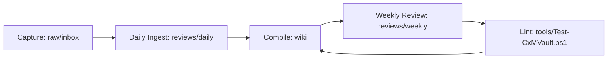

# CxMVault 总览

## 定位

`CxMVault` 是统一个人知识库，不绑定单一 agent。它服务两类使用者：

- 人：用 Obsidian 浏览、复盘、发现关联
- Agent：用稳定目录、索引、frontmatter 和维护契约读取、编译、验证知识

## 使用闭环

日常使用从 [[../00-开始使用|00-开始使用]] 进入。新文章、新知识、网页内容、截图和临时想法先进入 `raw/inbox/`，每天消化，每周复盘，每月整理结构。

## Karpathy 分层

- `raw/`：原始资料和 legacy source，不直接当作最终结论
- `wiki/`：LLM 编译后的结构化知识
- `schema/`：跨 agent 维护契约
- `reviews/`：每日消化、每周复盘、每月整理
- `logs/`：系统维护日志
- `outputs/`：报告、图谱和导出物
- `tools/`：健康检查和迁移辅助脚本

## 旧库关系

- `E:\CodeXData\CodeXKnowledge`：旧 Obsidian 项目知识库，作为 legacy source
- `E:\CodeXData\agentMemory`：旧项目机器记忆，作为 bridge source
- 旧库不被删除、不被搬空、不被静默覆盖

## 当前优先级

1. 保持旧项目经验可检索，避免重复犯错
2. 建立清晰的个人 + 项目知识结构
3. 把有长期价值的旧知识逐步编译进新 wiki
4. 用 lint 和来源追溯压住知识漂移
